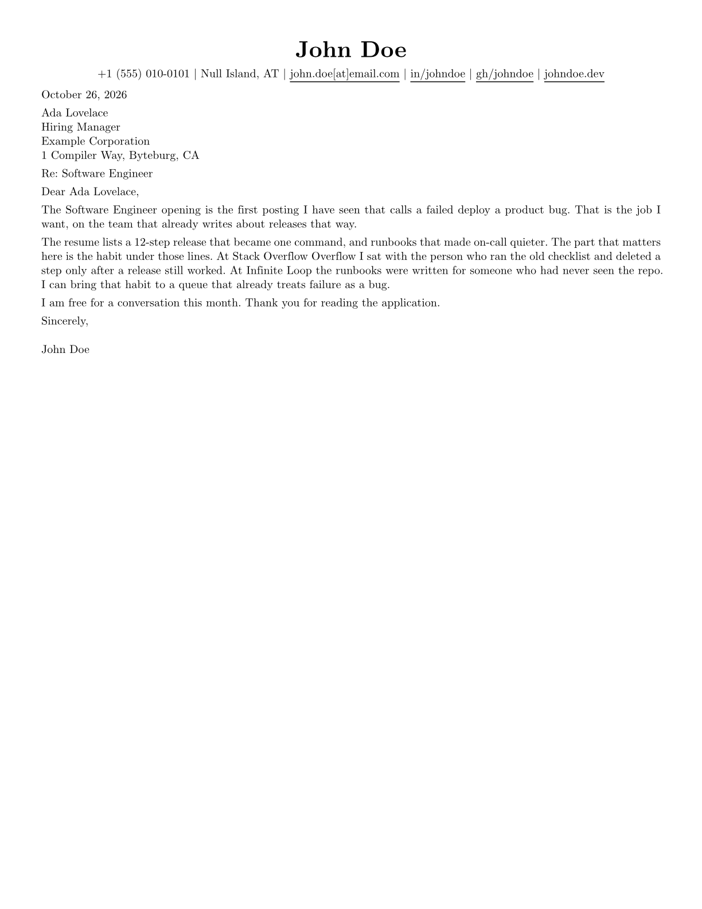

# Exp Cover Letter

A one-page cover letter whose header matches
[exp-resume](https://github.com/tahzeer/exp-resume-template). Same font,
sizes, contact row, and link color. The body is a letter, not a second
resume.

Keep real letters outside this repository. The only letter in git is the
John Doe starter.

## Sample



## What to write

Three paragraphs, one page.

1. Name the role and one reason you want that employer. Put a referral in
   the first sentence if you have one.
2. Tell one or two results as stories. The resume already lists them. Do
   not paste the bullets.
3. Ask for a conversation and thank the reader.

That shape is what the University of Michigan career center and the Harvard
Extension School resume guide both describe. Use the same name, contacts,
and accent as the resume.

## Quick start

```sh
typst init @preview/exp-cover-letter:0.1.0
```

```typst
#import "@preview/exp-cover-letter:0.1.0": *

#show: letter.with(
  author: "John Doe",
  email: "john.doe@example.com",
  accent-color: "#000000",
  date: "October 26, 2026",
  recipient-name: "Ada Lovelace",
  company: "Example Corporation",
  greeting: "Dear Ada Lovelace,",
  closing: "Sincerely,",
)

First paragraph.

Second paragraph.

Third paragraph.
```

Contact fields use the same names as `resume.with`. An empty string drops
that line. The [manual](docs/manual.pdf) lists every parameter.

## Local development

```sh
just install-preview
typst compile template/main.typ /tmp/exp-cover-letter-example.pdf
```

```sh
just ci
```

`just package out` builds a release candidate. `docs/manual.pdf` is
gitignored and rebuilt by the release workflow.

## Versioning

Versions follow [Semantic Versioning 2.0.0](https://semver.org/). Tags use a
`v` prefix and must match `typst.toml`. `./scripts/bump.sh` updates pins and
the changelog. Do not edit a version that has already been released.

## Publishing

A matching tag runs the release workflow. It pushes
`packages/preview/exp-cover-letter/<version>` to `tahzeer/typst-packages`.
The repository needs a `REGISTRY_TOKEN` secret that can push to that fork.
The fork stays public so the Typst Universe pull request can be opened.
